# 架構圖集：系統架構、元件組成、數據流

> 版本 v0.5（2026-10-23）。**第一階段定版三張圖**（2026-10-22 與研發、運維定案：3 台 VM Docker Compose、微批不上 Flink、事件表只增刪不改寫、OneID 回補查詢時換算；對照 PR #74／#75／#76）由 `docs/diagrams/build_phase1.py` 產生，PNG 由 `render_png.py`（Playwright／Chromium）產生。原四張圖是 GCP／第二階段的目標架構，保留在下方。
>
> | 圖 | 檔案 | 用途 |
> |---|---|---|
> | 系統架構圖（第一階段） | `diagrams/phase1-system-architecture.svg` / `.png` | 提案與評審：六層＋安全、觀測、部署、授權；底部為去重與 OneID 規則 |
> | 元件組成圖（3 台 VM 部署） | `diagrams/phase1-component-deployment.svg` / `.png` | 運維與資安：每台 VM 的容器、埠、入口、故障切換；對應 `deploy/compose/` |
> | 數據流圖（第一階段微批） | `diagrams/phase1-data-flow.svg` / `.png` | 工程與資料治理：六段資料流、關鍵規則（去重、先刪再寫、回補對照）、頻率與延遲 |
>
> 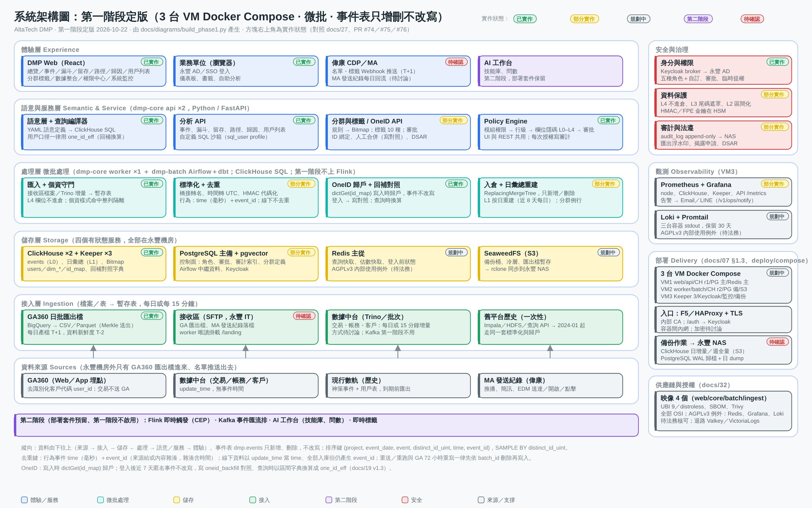
> 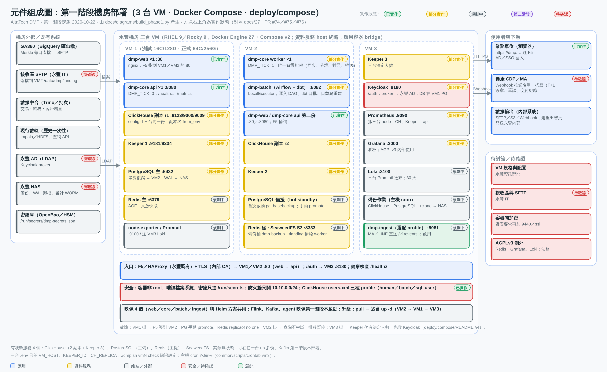
> 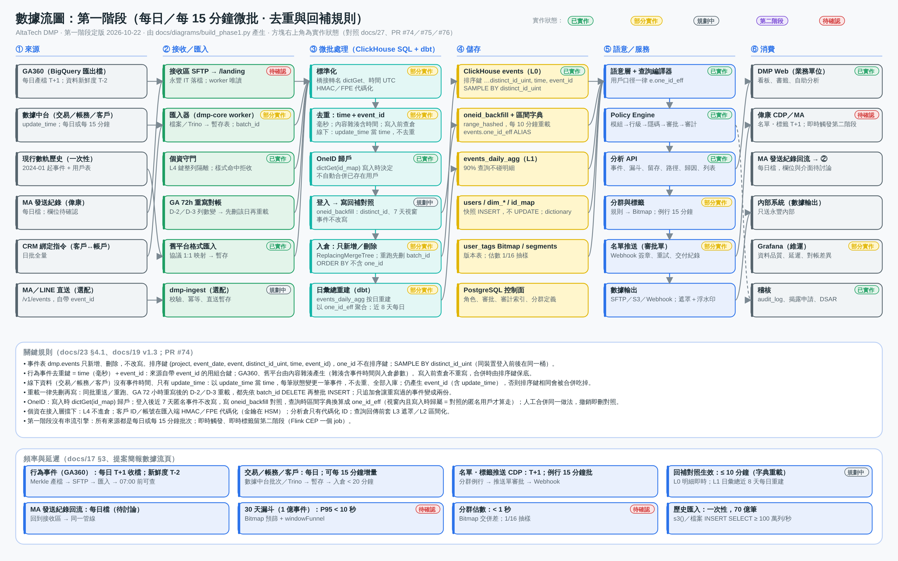
>
> 原版本 v0.4（2026-10-17）說明如下。四張圖由 `docs/diagrams/build.py` 產生（純 Python，無相依）；改資料結構後執行 `python3 docs/diagrams/build.py` 重新產生 SVG（加 `--list` 印出每個方塊的狀態），PNG 預覽以瀏覽器轉出。**v0.4 起每個方塊右上角標示實作狀態**（已實作／部分實作／規劃中／第二階段／待確認；`STATUS` 表對照 docs/27 §1，待確認清單見 docs/17 §5a）。下方另附 Mermaid 版本供 GitHub 直接渲染與快速修改。

| 圖 | 檔案 | 用途 |
|---|---|---|
| 系統架構圖（分層視圖） | `diagrams/system-architecture.svg` / `.png` | 提案與評審：六層（來源→接入→儲存→計算→語意服務→Agent→體驗）＋ 安全、觀測、部署、供應鏈 |
| 元件組成圖（GKE 部署視圖） | `diagrams/component-deployment.svg` / `.png` | 基礎設施與資安評審：節點池、Pod、託管服務、Ingress、邊界 |
| 元件模組圖（功能模組） | `diagrams/module-map.svg` / `.png` | 產品與開發：功能模組、負責的資料、模組間關係與資料流摘要 |
| 數據流圖 | `diagrams/data-flow.svg` / `.png` | 工程與資料治理：六段資料流、關鍵規則、延遲 SLA |

## 提案簡報版（16:9，`diagrams/slides/`，由 `build_slides.py` 產生）

一頁一個訊息、每頁不超過 12 個方塊、字級 20px 以上，可直接貼進 Google Slides 或 PowerPoint：

| 頁 | 檔案 | 訊息 |
|---|---|---|
| 1 系統架構 | `slides/slide-1-architecture.png` | 一個中台承接 GA360 行為軌跡與證券交易事件；四大能力 + 基礎 + 治理 |
| 2 數據流 | `slides/slide-2-data-flow.png` | 五個步驟、五個延遲承諾 |
| 3 AI Agent | `slides/slide-3-ai-agent.png` | 選擇題式 agent 流程、六個內建 agent、金融業守門 |
| 4 GCP 部署與規模 | `slides/slide-4-gcp-deployment.png` | 3 個節點池 7 台、託管服務、安全、月費 |
| 5 機房部署架構 | `slides/slide-5-onprem-deployment.png` | 平台應用／資料層（5 個有狀態）／平台層／每節點 DaemonSet；備份與 HA；對照 2025/07 舊棧 |

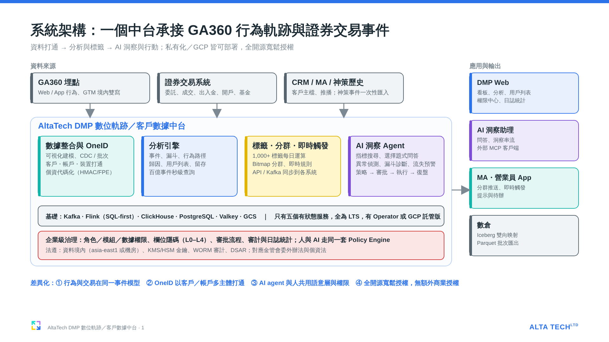
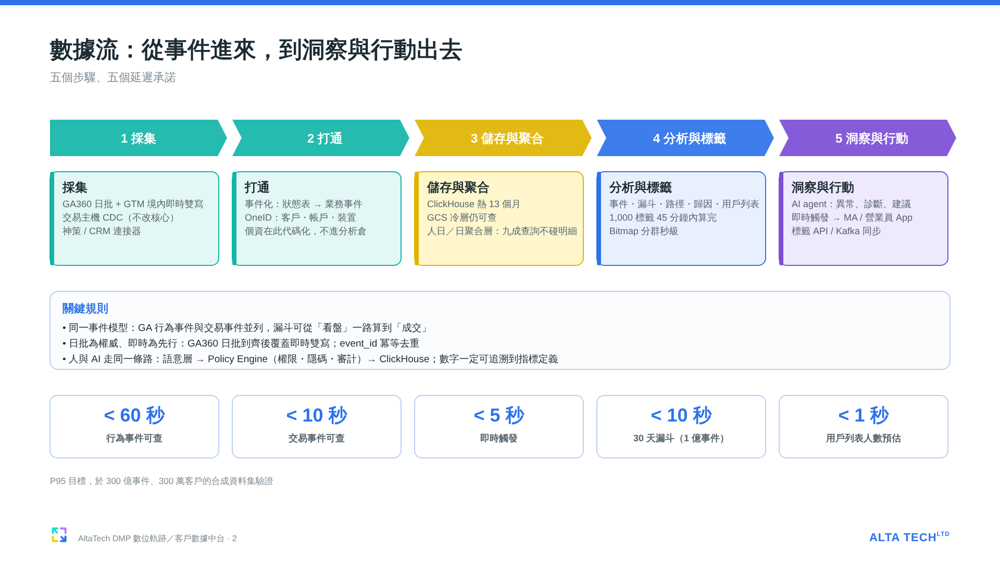
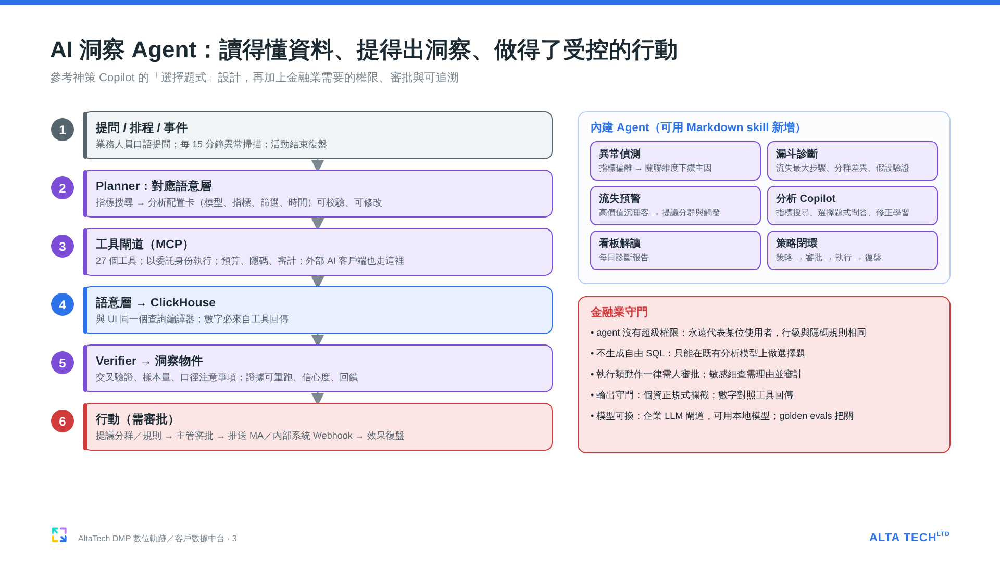
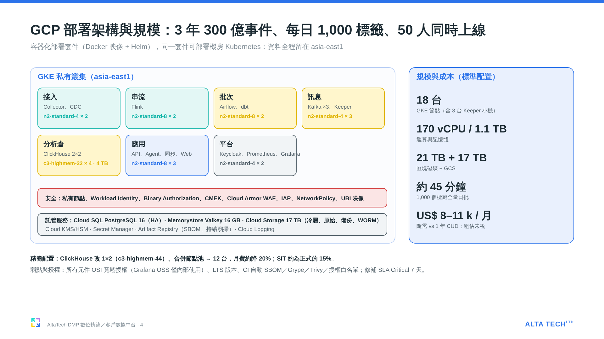

## 工程版（詳細）

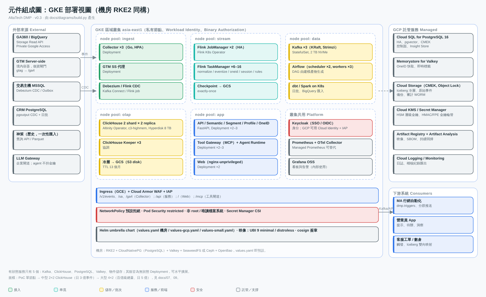

## Mermaid 版本

### 系統架構（分層）
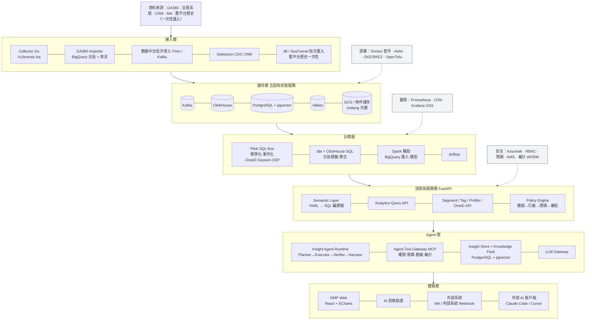

### 元件組成（部署）
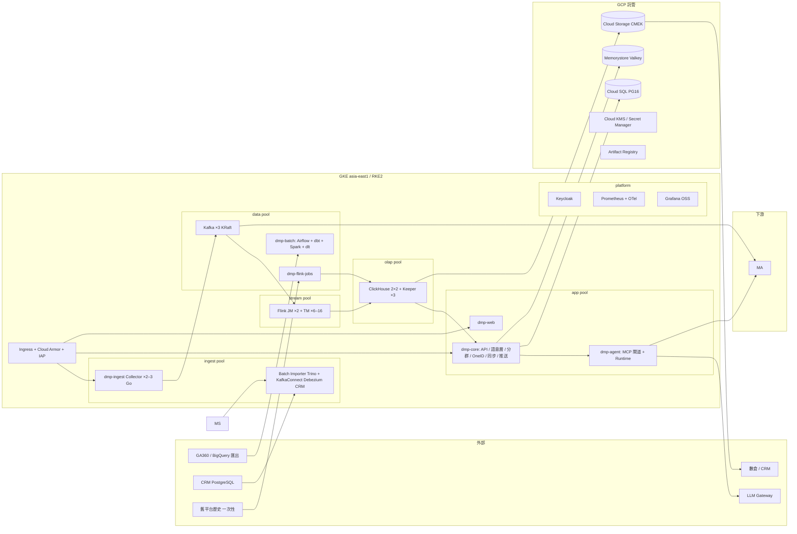

### 數據流
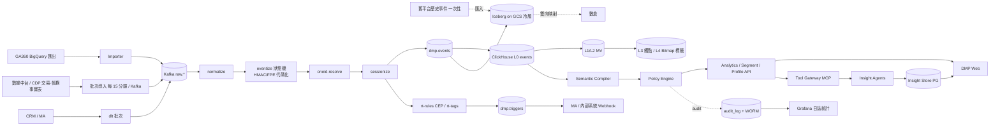
