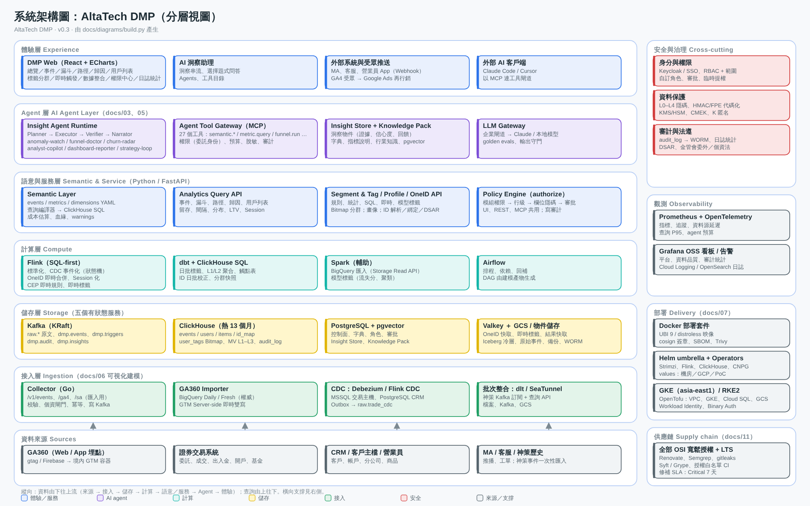
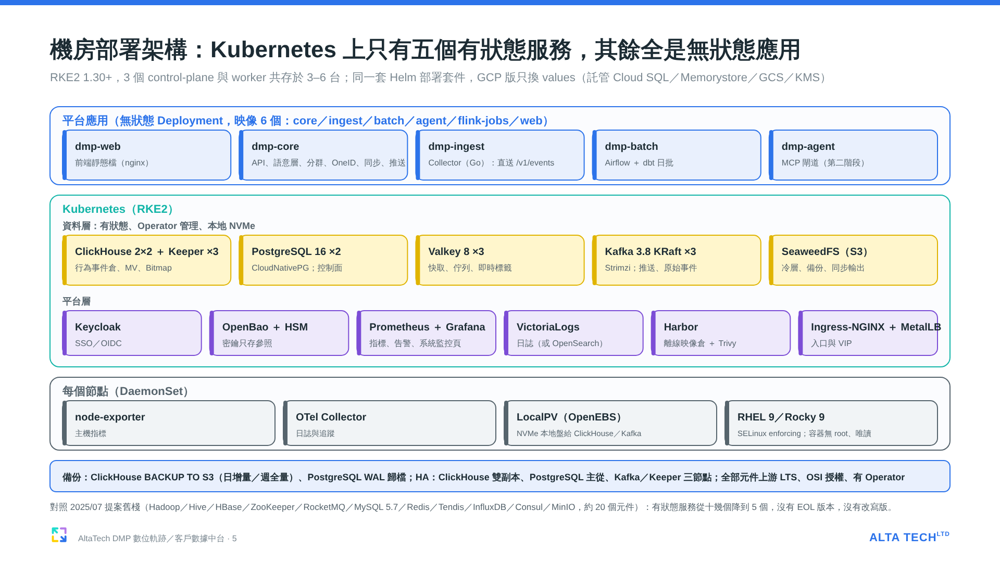
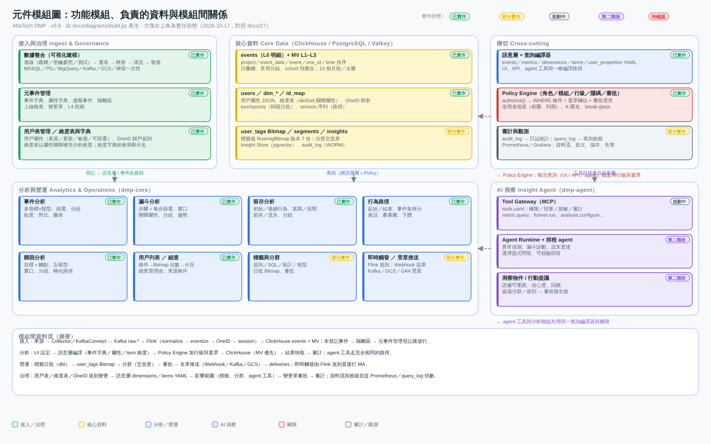
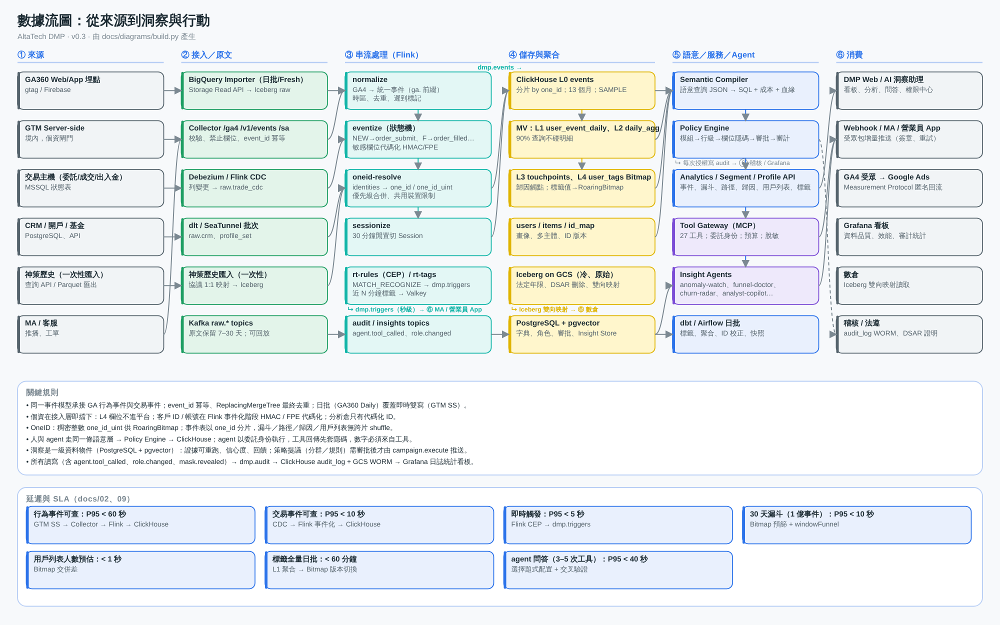

# AltaTech DMP 產品規格書（v0.9.3，2026-10-22）

> 版本：v0.9.3 — **10/19–10/22 進度回寫**：數據輸出已實作（後端、前端、示範站）；事件分析行為篩選與對照組已實作；個資不入庫加強（舊平台匯入與隔離區都不留個資原值，docs/42 遷移校驗方法論）；事件 ID 改為內容雜湊、日彙總改為可重建且冪等（中斷、重送、併發、舊版升級都會補完）；AD 一律經 Keycloak 接入（已決定，實作審查中）；**AI 分析工作台**依 Windy 2026-10-21 授權先開發已確認範圍（D1 MVP、D2 執行架構、D3 模型可見範圍、D4、D5 技能庫基礎管理；RFC 草案 docs/38–41 見 PR #36），契約與後端基礎已合併，前端與正式模型未上線；§5a 狀態表與待確認清單同步更新。
>
> v0.9.2 — 新增 §1.1 機房部署示意圖與開源元件表（與提案簡報 14b–14d 同源，docs/37 §4）。
>
> v0.9.1 — 對外版本：廠商與產品名稱改為中性用語（客戶既有行為分析平台稱「舊平台」，比較對象稱「同類商用 CDP」）。
>
> v0.9 — **舊平台埋點規格表對齊**：事件字典補上規格表 147 個自訂事件（共 264 個，17 個已停用只匯歷史）；用戶表比導出多的 36 欄列入遷移清單待確認；分公司＋帳號欄改 L3、加密參數（ivKey／hashKey／svid）不入倉不送 GA；元事件、事件屬性、用戶表屬性可下載範本與整批上傳（先預覽再套用）；事件分析人數預設精確、「快速估算」才走聚合層近似值；示範站改用依規格合成的 100 萬人模擬資料（1,000 萬筆行為資料＋500 萬筆交易資料，另含情境流程；數位開戶漏斗依市場經驗值設定各步續行率：開戶首頁→審核成功 15%、每月約 2 萬戶開戶成功）。
>
> v0.8 — **實作狀態標註**：四張系統圖每個方塊右上角標示 已實作／部分實作／規劃中／第二階段／待確認（`docs/diagrams/build.py` 的 `STATUS` 表，對照 docs/27 §1）；新增 §5a 實作狀態總表與待確認清單（取代原 §8 的轉介）。
>
> v0.7 — 範圍調整：本案主軸改為「舊平台 → GA360 遷移與歷史資料銜接」四件事（埋點設計建議、舊平台資料盤點與導出載入、新舊整合測試、交易資料導入與結合分析；docs/22）；**第一階段不做 AI 功能**，契約與原型頁面保留（功能旗標關閉）供第二階段接入；新增模組 5.17 歷史資料遷移、連接器 legacy_export、橋接工具 bridge.py；時程改為 M1–M5（第 20 週驗收）。
>
> v0.6 — 同步原型 v0.6.1：五種角色（docs/10 v0.4）、事件字典改用客戶模擬事件清單（112 個舊平台事件 + 別名）、交易／帳務改由數據中台／CDP 批次導入、GA360 去識別化埋點（docs/20）、OneID 登入後改寫（docs/19 v1.1）、分群／標籤／自定義 SQL 對齊舊平台（docs/21）、五個分析模組對齊舊平台使用指南（docs/04 §0b）、導覽拆成「數據治理」「系統管理」兩個大模組、系統管理員可新增刪除角色。

> 本文是總規格：每一節給結論與圖，細節連到對應文件。讀者：客戶 PO／架構／資安／採購、AltaTech 開發團隊。對應原型 v0.7.0（demo）、後端契約 `backend/`、部署套件 `deploy/`。

## 0. 一頁摘要

| 項目 | 內容 |
|---|---|
| 本案主軸 | 客戶既有行為分析平台（下稱「舊平台」）因政策因素停用、行為埋點改 GA360，歷史資料須保留並連續分析：① 依舊平台事件／用戶表給 GA360 導入商埋點設計建議（正式事件名 = 舊平台事件名，GA 事件名以橋接表轉回）；② 舊平台資料盤點、導出、載入；③ 新舊資料整合測試（T1–T9、並行期雙軌對帳）；④ 數據中台交易資料導入與結合分析（docs/22） |
| 產品 | 可私有化部署的數位軌跡／客戶數據中台：承接 GA360 埋點事件（去識別化客戶代碼，docs/20）與數據中台／CDP 批次導入的證券交易／帳務事件，OneID 打通（含登入後 7 天匿名事件改寫，docs/19），提供事件／漏斗／留存／路徑／歸因／用戶列表六個分析模組 + 自定義 SQL、分群與標籤（對齊舊平台分群／標籤管理，docs/21）、即時觸發與受眾推送；AI 分析工作台（DMP 後端控制流程、模型只看彙總結果；已確認範圍開發中，正式模型未啟用，§5.13）；數據治理（元事件／用戶表／維度表／資料流／歷史資料遷移）與系統管理（權限中心／審計／平台設定）兩個大模組；五種角色（系統管理員、行銷、數據分析、數位經營、資訊管理）＋自訂角色、欄位隱碼、審批與審計 |
| 對標 | 舊平台 v3.0（事件／漏斗／留存／路徑／歸因使用指南、分群、標籤管理、自定義查詢、用戶畫像）與同類商用 CDP／埋點分析產品（docs/01、04 §0b、05、21） |
| 規模 | 3 年 220 億事件（含舊平台歷史 70 億，docs/13 v0.7 勘誤）、每日 500 個標籤、50 人同時上線、尖峰 7,000 事件/秒（docs/13） |
| 部署 | 6 個自建映像 + Helm + OpenTofu；正式 GCP A 檔 6 台（或 D 檔 3 台大機型），測試 C-經濟 3 台；機房 RKE2 同一套件（docs/07、13） |
| 授權 | 全部 OSI 寬鬆授權（Grafana OSS 僅內部使用），金融業無需額外商業授權（docs/07、11、LICENSES.md） |
| 人力 | AltaTech 七人：產品 1、研發 2（vibe coding，分「資料與查詢」「應用與前端」）、PM 1、數據分析師 2（A 遷移與口徑；B 教育訓練、儀表板重構、上線後交付調優）、運維工程師 1（PM、分析師 A、運維服務過本客戶舊平台）；全員 Claude Team 帳號，協同方式見 docs/31 §2b；外加 ClickHouse 顧問 20 天 |
| 時程 | M1 盤點與橋接表第 3 週、M2 歷史資料進倉第 7 週、M3 GA360 接入與並行第 11 週、M4 交易結合與營運第 15 週、M5 內部驗收第 19 週；UAT 2027-06-30、正式上線 PD 2027-09-30（docs/22 §6）；AI 分析工作台不列入第一階段驗收，已確認範圍先行開發（§5.13） |

## 1. 系統架構圖

> 圖上狀態標籤：🟢 **已實作**＝程式在 repo、有自動化驗證、示範站可演示；🟡 **部分實作**＝核心路徑可用、方塊內有列出但尚未做的項目；⚪ **規劃中**＝第一階段範圍內、尚未動工；🟣 **第二階段**＝第一階段明確不做（AI 洞察、Flink 串流、即時觸發）；🔴 **待確認**＝需客戶／PO 決定或實測後才能定（§5a 清單）。外部來源不標。

分層：來源 → 接入（Collector／KafkaConnect）→ 串流（Kafka、Flink 事件化、OneID、session）→ 儲存（ClickHouse 熱層 + MV、Iceberg 冷層、PostgreSQL 控制面、Valkey）→ 語意層與 Policy Engine → 服務（六個分析模組、標籤／分群、觸發／推送、AI 工具閘道）→ 前端與 API；橫切：身分與權限、資料保護、審計與法遵、觀測、部署。詳見 docs/02、12。

### 1.1 系統部署示意圖與開源元件（機房；GCP 版見 docs/07 §1 與 diagrams/slides/slide-4）

- 平台應用全為無狀態 Deployment（映像 6 個）；有狀態服務只有 5 個（ClickHouse ＋ Keeper、PostgreSQL、Valkey、Kafka、物件儲存），皆由 Operator 管理、本地 NVMe；平台層 Keycloak、OpenBao、Prometheus ＋ Grafana、VictoriaLogs、Harbor、Ingress ＋ MetalLB；每節點 node-exporter、OTel Collector、LocalPV。
- 備份：ClickHouse `BACKUP TO S3`（日增量／週全量）、PostgreSQL WAL 歸檔；HA：ClickHouse 雙副本、PostgreSQL 主從、Kafka／Keeper 三節點（docs/13 §11.4）。
- 版本為 2026-10 的 LTS，M1 開工時依當時 LTS 重釘；原則不變：上游版本、不改寫、OSI 授權、有 Operator 或託管版（docs/32 為完整清單與來源國別，docs/37 為與舊棧的逐項對照）。

| 類別 | 元件 | 版本 | 授權 | 功能說明 |
|---|---|---|---|---|
| 容器平台 | Kubernetes（RKE2）／GKE | 1.30+ | Apache-2.0 | 容器編排；3 個 control-plane 與 worker 共存 |
| 容器平台 | Helm、OpenTofu | 3／1.8 | Apache-2.0／MPL-2.0 | 一套 umbrella chart 部署；IaC |
| 容器平台 | Harbor | 2.x | Apache-2.0 | 離線映像倉；Trivy 弱掃 |
| 線上存儲 | PostgreSQL ＋ pgvector（CloudNativePG） | 16 | PostgreSQL License | 控制面：看板、分群定義、審批、審計索引、洞察向量 |
| 線上存儲 | Valkey | 8 | BSD-3 | 快取、工作佇列、即時標籤（第二階段） |
| 分析存儲 | ClickHouse ＋ Keeper（Altinity operator） | 25.8 LTS | Apache-2.0 | 行為事件倉、MV 聚合層、分群／標籤 Bitmap、用戶檔案字典 |
| 分析存儲 | SeaweedFS（機房）／GCS | 3.x | Apache-2.0 | S3 API：Iceberg 冷層、原始事件、備份、同步輸出 |
| 訊息 | Apache Kafka（KRaft，Strimzi） | 3.8 | Apache-2.0 | 推送更新、原始事件落地；第二階段即時觸發輸入 |
| 計算 | Apache Airflow ＋ dbt-core | 2.10 | Apache-2.0 | 日批排程與 SQL 轉換（第一階段由 API 內建排程器執行） |
| 計算 | Apache Flink ＋ K8s Operator | 1.20 | Apache-2.0 | 第二階段：即時觸發 CEP（套件含、未啟用） |
| 計算 | Apache Spark／Trino／Iceberg | 3.5／4xx／1.6 | Apache-2.0 | 第二階段：70 億歷史重算、冷層查詢 |
| 身分與密鑰 | Keycloak；OpenBao ＋ HSM（機房）／Secret Manager ＋ KMS（GCP） | 25；2.x | Apache-2.0；MPL-2.0 | SSO／OIDC；密鑰只存參照 |
| 觀測 | Prometheus ＋ OTel Collector ＋ node-exporter；Grafana OSS | 2.x／0.1x；11.x | Apache-2.0；AGPL-3.0（內部使用） | 指標與告警；平台「系統監控」頁同源 |
| 觀測 | VictoriaLogs（或 OpenSearch；docs/37 §5.2） | 1.x／2.x | Apache-2.0 | 日誌 |
| 執行環境 | Python、Go、Node、Temurin JDK | 3.12、1.23、22 LTS、17 | PSF／BSD／MIT／GPLv2+CE | core／ingest／web／Flink |
| 作業系統 | RHEL 9／Rocky Linux 9；UBI 9 minimal 映像基底 | 9.4+ | — | SELinux enforcing；容器無 root、唯讀檔案系統 |

## 2. 元件模組圖

功能模組與它們負責的資料、模組間關係：數據治理（數據整合、元事件管理、用戶表／維度表、資料流與效能）→ 核心資料（events + MV + oneid_backfill 覆蓋表、users／dim_*／id_map、Bitmap／segments／user_tags／insights／mid_tables）；分析（六模組 + 自定義 SQL）、營運（分群與標籤、觸發／推送）與 AI 洞察都經「語意層 + 查詢編譯器」與「Policy Engine」存取資料；系統管理（權限中心、日誌統計、平台設定）橫切所有模組。部署視圖（節點池、Pod、託管服務）見 `diagrams/component-deployment.png`（docs/12）。

## 3. 數據流圖

| 流 | 路徑 | 延遲目標 |
|---|---|---|
| 準即時行為 | GA360（user_id = 去識別化客戶代碼 `v1_…`，登入時由 ID 服務簽發；user_pseudo_id 為匿名 distinct_id）BigQuery 串流匯出（events_intraday_）→ Importer → Kafka raw → Flink（normalize／eventize（GA 事件名經橋接表轉回舊平台正式事件名；別名 → 正式事件名）／OneID／session）→ ClickHouse | 分鐘級（P95 < 15 分鐘，受 GA 串流匯出延遲限制） |
| 日批行為 | GA360 BigQuery 日批匯出（events_，權威）→ Storage Read API → Kafka raw → 同上；event_id 去重，覆蓋串流 | 前日資料 07:00 前到齊 |
| 交易／帳務 | 數據中台／CDP 事實表批次導入（每 15 分鐘增量 + 日批校正；數據中台有 Kafka 則流任務）→ Kafka → Flink 狀態機事件化（委託／成交／失敗／刪單）；不直連交易主機 | < 20 分鐘（批次）／< 1 分鐘（Kafka） |
| 主檔 | CRM／HR／商品主檔 → 建模映射 → users／items | 每日 |
| 分析查詢 | UI／API／agent → 語意層編譯 → Policy（行級、遮罩）→ ClickHouse（MV 優先）→ 快取 → 審計 | 各模組 P95 SLA 見 §5.9 |
| 舊平台歷史資料（一次性） | Impala／HDFS Parquet 直讀（IDM 2.0：second_id → 客戶代碼，first_id 保留為匿名）→ Importer（legacy_export）→ 暫存 Parquet → ClickHouse SQL 標準化（事件名保留、時間轉 UTC、`$ip` 丟棄、登入 ID HMAC 成客戶代碼；第一階段微批，不經 Flink，docs/23）→ ClickHouse 歷史分區 → 三方對帳（來源／導出／載入） | 70 億約 2–3 天（Impala／HDFS 直讀，客戶已同意）；分片差異 > 0.1% 重跑 |
| OneID 登入改寫 | 登入／綁定事件 → 查該 distinct_id 近 7 天仍歸匿名用戶的事件 → 寫入 oneid_backfill 覆蓋表（查詢即時生效）→ 每 10 分鐘微批 lightweight update 回寫 events（≤ 8 個日分區）→ 審計 oneid.backfilled；拒絕同意者不改寫 | 覆蓋表即時；回寫 < 10 分鐘 |
| 標籤與分群 | 例行（日／週／月）或手動計算 → user_tags Bitmap（保留 1–100 版）→ 分群（規則／匯入／結果存檔；交／聯／差；1/16 抽樣估數）→ 審批 → 推送紀錄 | 日批 < 20 分鐘；500 分群估數 < 3 s |
| 名單推送 | 分群／標籤 → 推送單審批 → Webhook／Kafka／GCS（內部系統）→ deliveries | 增量 15 分鐘送完 |
| 自定義 SQL | 編輯器（唯讀 SELECT／WITH）→ 脫敏預校驗 → 語意層表目錄（依權限）→ ClickHouse（1,000 列預覽）→ 可視化／下載／存為概覽或中間表 → 審計 | 預覽 < 10 s；下載上限依角色 |
| 數據治理 | 元事件／屬性／用戶表／維度表／OneID 規則變更 → 語意層 YAML → 影響範圍 → 變更單 → 審計 | 即時生效（上線）或審批後 |
| 系統管理 | 權限中心（角色／指派／數據權限／審批）、日誌統計（審計看板）、平台設定 → 審計 role.*／iam.* | 即時生效；角色變更雙人複核 |

每個模組讀寫哪些資料見 docs/18 §2 與原型「資料流與效能」頁。

## 4. 資料模型與語意層

- Event–User–Item 模型，舊平台相容協議（track／profile_*／item_*／identities）與 GA4 匯出映射（docs/01、06）；OneID 歸戶對齊舊平台 IDM 3.0，匿名用戶也有 distinct_id，登入後改寫近 7 天匿名事件（docs/19 v1.1）。
- 事件字典 v4（`events.yaml`，共 264 個）：客戶模擬事件清單 112 個 ＋ 3 個補充交易事件 ＋ 舊平台埋點規格表 147 個自訂事件（2026-10-19 補；依平台判斷來源，標 (X)／已下線／過期活動的 17 個為 deprecated，只匯歷史；required 只列保留或代碼化的屬性，個資與維護欄不列）。模擬清單的 112 個舊平台事件（開戶 kh_*、定期定額 sip_*、申購／競拍 auc_*、行情 hq_*、活動 act_*、證券 bond_*、$App*／$pageview 等基礎事件、$Plan*／$Journey* 智能運營事件、LINE／Push／短鏈）＋ 3 個補充交易事件；每個事件帶 group／platforms／source／aliases，舊名（ga.page_view、quote_view、order_submit…）以別名映射到正式事件名（docs/04 §0a）。
- 新舊銜接：正式事件名 = 舊平台事件名；GA 端事件名由 `backend/migration/bridge.py` 由事件字典產生（264 事件：157 經 GA〔自訂 155、自動 2〕、59 由數據中台／業務系統／渠道／短鏈直接接入、48 只匯舊平台歷史〔MA／LINE 與已停用事件〕），接入時以 `legacy_ga4_bridge.yaml` 轉回；登入用戶兩邊同一客戶代碼，匿名 ID 不銜接（docs/22 §2）。
- 去識別化：一把 HMAC 金鑰（HSM）產生 `v1_` + 20 字元客戶代碼，GA `user_id` 與舊平台 `$identity_login_id` 同款；手機 HMAC／帳號 FPE 不送 GA；行為事件與交易事件不逐筆對帳，只靠 OneID 歸戶（docs/20）。
- ClickHouse：`events`（L0，按 project／event_date／event／one_id／time／event_id 排序，月分區，13 個月熱層）、MV L1–L3、`oneid_backfill`（登入改寫覆蓋表）、`users`、維度表 `dim_*`（dictionary）、`id_map`、`user_tags`（Bitmap）、`segment_members`、`audit_log`（`backend/clickhouse/*.sql`）。
- 語意層 YAML：`events.yaml`、`metrics.yaml`、`dimensions.yaml`、`dimension_tables.yaml`（維度表／字典／虛擬屬性）、`user_properties.yaml`、`oneid_rules.yaml`、`ga4_mapping.yaml`；UI、API、agent 工具走同一查詢編譯器。
- 敏感等級 L0–L4：L4 永不入倉；L3 代碼化；L2 匯出區間化；依角色遮罩（docs/10）。

## 5. 模組規格（每模組：功能、輸入／輸出、權限、效能、契約）

| 模組 | 功能要點（對標舊平台與同類商用 CDP） | 契約 | 權限 | 效能目標（P95） | 細節 |
|---|---|---|---|---|---|
| 5.1 數據整合（數據治理） | 數據源管理（含 dwh 連接器：數據中台 Trino／Hive／Iceberg 或 Kafka，Kerberos／OAuth2／mTLS）（鑑權方式排序、密鑰參照不入庫、逐步測試、最小權限自檢、輪替）→ 數據表管理（Schema 探索、主鍵／增量欄位、版本與變更）→ 同步任務（目標 events 只增量／users upsert／維度表／OneID 綁定／標籤；全量／增量／流任務；排程、依賴、日誌、重試、Schema 變更處理）→ 清洗與隔離；建立任務走七步精靈；**數據輸出**（資料輸出任務：實時／一次／每日 T+1 × 事件明細／用戶寬表／分群名單 × 目的地 SFTP／S3／GCS／Kafka／Webhook × 格式；走匯出審批（新目的地首次使用另需系統管理員核准）、遮罩與浮水印；已實作，目的地先支援 SFTP／S3，Kafka／GCS／Webhook 沿用推送目的地規劃） | `/v1/integration/*`、`/v1/exports/tasks*` | integration v/u/d | 連線測試 < 15 s；發佈後首批資料 < 5 分鐘 | docs/06 §7–8 |
| 5.2 元事件管理（數據治理） | 事件字典（v4：以客戶事件清單為準，分組／平台／來源／別名）（狀態：草稿／上線／隔離／停用）、事件 CRUD 與上線檢查（命名、負責人、屬性型別與敏感等級、無 L4）、屬性字典（型別只放寬、敏感只升）、虛擬事件、隔離區登記（30 天丟棄）、變更單審批、路徑節點規則、範本下載與整批上傳（CSV；先逐列預覽新增／更新／變更單／錯誤，再套用；規則同單筆登記；≤ 2,000 列） | `/v1/meta/events*`、`/v1/meta/properties`、`/v1/meta/virtual-events`、`/v1/meta/quarantine`、`/v1/meta/templates/*` | governance v/d | 上線即生效（語意層、Collector、Flink） | docs/18 |
| 5.3 用戶表管理（數據治理） | 用戶屬性（來源、更新、敏感、可篩選／分組、覆蓋率、分桶）、profile_* 協議、OneID 規則（識別優先序、強度、合併策略、登入後改寫窗口、合併／拆分由資訊管理發起、系統管理員審批）、個資防護（L4 清單、偵測規則）、DSAR、用戶屬性範本下載與整批上傳（語意層既有屬性只能走契約） | `/v1/meta/user-properties`、`/v1/meta/oneid/rules`、`/v1/meta/templates/user-properties*` | governance v/d | — | docs/18、`semantic/user_properties.yaml` |
| 5.4 維度表與字典（數據治理） | 維度表（以「屬性值 = 主鍵」補充事件／用戶沒有埋的維度，欄位成為關聯屬性；主鍵唯一；< 100 萬列否則 dictGet）、維度字典（值 → 顯示名，1:1／N:1，新增／覆蓋）、虛擬屬性（表達式，查詢時計算） | `/v1/meta/dimension-tables*`、`/v1/meta/dictionaries*`、`/v1/meta/virtual-properties` | governance v/d | 同步依任務（即時～每日） | docs/06 §7.2、`semantic/dimension_tables.yaml` |
| 5.5 事件分析 | 多指標 × 指標類型（總次數／用戶數／人均／去重／求和、均值、最大、最小、中位、四分位、P90、MAU）、公式指標（A/B 四則）、指標篩選與全局篩選（且／或巢狀、`$event_hour` 時段、分群條件）、按分組（≤3 維、Top N）、粒度（分鐘～合計）、靜態／動態時間、對比模式（上期／同期／自訂）、合計精確／快速（HLL 近似）、折線／柱狀（百分比、按分組）／堆疊／累計／餅圖／表格（分層／平鋪、環比）、Excel 匯出、下鑽用戶列表、儲存報表 | `/v1/analytics/events` | events v/u/e | 3 s（MV 命中 < 1 s） | docs/04 §0b、§1 |
| 5.6 漏斗分析 | 用戶數／次數口徑、步驟（≤64、別名、每步篩選）、窗口（值＋單位）、關聯屬性、全局篩選、單／多維分組、時間粒度、限定窗口內轉化（limitInRange）、對比模式、同屏指標、去重／加權聚合、漏斗模板、漏斗圖／趨勢／對比視圖、樞紐／平鋪表與欄位顯示、步驟明細（轉化率、中位時長、流失）、下鑽流失／轉化用戶 | `/v1/analytics/funnel` | events | 5 s | docs/04 §0b、§2 |
| 5.7 留存分析 | 模型（按日期／按區間／連續留存／流失）、初始／後續行為各自篩選、任意事件、日／週／月、期數與區間、含當日、關鍵窗口、去重／加權聚合、顯示口徑（比例／人數／LTV）、用戶篩選＋關聯屬性篩選、分組來源與模式、合計列；留存表（平均列、格子下鑽至用戶列表）、曲線、分組表 | `/v1/analytics/retention` | events | 5 s | docs/04 §0b、§7 |
| 5.8 行為路徑 | 起始／結束事件（結束可選「離開 App」= `$AppEnd` 或會話逾時）、參與事件集（按屬性拆分；虛擬事件不參與）、步數、會話間隔、合併重複、會話（預設）／用戶口徑、抽樣、篩選、分群；桑基圖節點可點選（節點詳情：流出、下一步清單）、路徑高亮、以節點為新起點、下鑽用戶列表、匯出；Top 路徑過濾；節點表 | `/v1/analytics/path` | events | 8 s（SAMPLE 1/10） | docs/04 §0b、§3 |
| 5.9 歸因分析 | 目標事件與指標（總次數／數值求和）、觸點（命名、事件、篩選；共同／單一／合併觸點分組模式）、前向關聯事件（OR 清單）、五模型（位置權重、半衰期可調）與對比、窗口模式（當天／自訂）、用戶篩選 vs 全局篩選、轉化粒度、分組；結果欄位依舊平台數據口徑（觸點次數、直接／輔助轉化、歸因值、佔比）、表格模式與欄位開關、轉化路徑、模型差異 | `/v1/analytics/attribution` | events | 5 s | docs/04 §0b、§4 |
| 5.10 用戶列表／細查 | 條件 → Bitmap 估數 → 分頁；來源條件下鑽（事件／漏斗／留存／路徑／歸因）；存為分群／匯出（審批、浮水印、上限）；細查需理由、身分圖、時間軸 | `/v1/users`、`/v1/profiles/*` | users、profile | 估數 1 s；分頁 2 s；細查 1 s | docs/04 §5 |
| 5.11 分群與標籤 | 分群：建立方式（規則／匯入／分析結果存檔）、規則類型（屬性／事件／分群／函數／行為序列）、巢狀且／或、規則組交／聯／差、1/16 抽樣估數、排序與截斷、手動／例行更新、版本保留、暫停／複製、血緣、推送紀錄、回收站（還原／清除）、≤500 個；標籤：10 種建立方式（自訂、指標、首末次、偏好、分布、計算、RFM、SQL、生命週期、匯入）、型別（字串／數值／列表／日期／布林）、例行頻率（日／週／月）、保留 1–100 版、審批、自訂欄位、分布、血緣、回填、回收站；Tag Sync API（REST／Kafka／GCS） | `/v1/segments*`、`/v1/tags*`、`/v1/sync/*` | segments、tags v/u/a；審批 → 數位經營 | 估數 < 3 s；500 分群／標籤日批 < 20 分鐘 | docs/21、04 §6、09 |
| 5.12 即時觸發／受眾名單推送 | Flink 規則引擎；目的地皆為內部系統（Webhook 簽章／批次／重試／DLQ、Kafka、GCS）；推送單審批、交付紀錄；廣告平台不在範圍 | `/v1/triggers*`、`/v1/destinations*`、`/v1/audiences/*/push` | triggers、segments a | 即時 < 5 s；批次 15 分鐘 | docs/14 |
| 5.13 AI 分析工作台（已確認範圍開發中；正式模型未啟用） | **DMP 後端控制流程、模型以可替換的 API 呼叫**（D2）；工具閘道（tools.yaml v1：身分只取自執行者、每次呼叫重新授權、送查詢前預估掃描量並扣預算、統一回應信封、審計）；**模型只看目錄與彙總結果**（D3：≤200 列、遮罩與 K 匿名後、金額區間、無 ID；畫面數字由 DMP 直接給，不經模型轉述）；執行紀錄（狀態機、租約圍籬、寫入冪等）；**技能庫**（D5：技能版本、草案、乾跑比對、他人核可、回復；業務口徑可在前端檢視與編輯，工具清單與模型可見範圍不可改）；第一個 MVP（D1）：開戶漏斗診斷（只讀）→ 開戶主管週報看板草稿 → 「開戶滿 7 天、有登入、未交易」受眾草稿（不送審、不推送）；所有會生效的動作仍由人按 | `/v1/agents/runs*`、`/v1/agents/skills*`、`/v1/agents/configs*`、MCP 工具（tools.yaml v1） | ai_ask、ai_admin、ai_skills（view／use／approve，角色分配待核定） | 工具呼叫 5 s；預算依 tools.yaml（單次／單 run 掃描上限） | docs/38–41（RFC 草案，PR #36）、docs/03、05、30 |
| 5.13b 自定義 SQL | 數據庫表目錄（依權限：events、users、user_tags、segment_members、dim_*、id_map 僅資訊管理／系統管理員、中間表）、函數庫、SQL 編輯（格式化／解釋／動態參數）、只允許 SELECT／WITH（去註解後檢查）、遮罩欄位預校驗（手機／證號／姓名／Email 直接報錯）、1,000 列預覽與可視化（表格／折線／柱狀／堆疊／組合／環圖）、查詢記錄、已存查詢、存為概覽／書籤／中間表、下載審計 | `/v1/sql/*` | can.sql：數據分析、資訊管理、系統管理員 | 預覽 10 s；掃描預算依角色 | docs/21 §3 |
| 5.14 權限中心（系統管理） | 角色（五種：系統管理員、行銷、數據分析、數位經營、資訊管理 + 自訂、勾選權限；系統管理員可新增／刪除任何角色，admin 本身不可刪，仍有指派時須改派、雙人複核、審計 role.deleted）、使用者指派（多角色、範圍、到期、SSO 群組、臨時提權）、模組矩陣（v/u/e/a/d）、數據權限（專案／分群限制／回溯／K 匿名；組織範圍保留給自訂角色）與行級模擬、欄位隱碼（L3 明文僅系統管理員；L2 數據分析／數位經營）、審批（分群／推送／觸發／agent 提議／匯出／L2 揭露 → 數位經營；新目的地首次全量推送／L3 揭露／break-glass／OneID 合併 → 系統管理員） | `/v1/iam/*`、`/auth/*` | iam v/d | authorize() < 5 ms | docs/10 v0.4、docs/24（前端框架、SSO／AD 登入） |
| 5.15 日誌統計／審計（系統管理） | 全部人與 agent 的讀寫審計（含 oneid.backfilled、role.*、sql.*）；看板：使用概況、敏感存取、審批、異常 | `/v1/governance/audit*` | audit | — | docs/10 §7–8 |
| 5.17 歷史資料遷移（數據治理） | 盤點（資料集、位置、量、導出方式、目標、狀態）、埋點銜接（橋接表：舊平台事件 → GA4 事件名／類型／參數、未解議題、CSV 下載給導入商）、導出／載入任務（按日分片進度、三方筆數、校驗、重跑）、新舊對帳（每事件每日舊平台 vs 載入、並行期舊平台 vs GA360、用戶銜接率）、切換時序 | `/v1/migration/*` | governance v/d；資訊管理、系統管理員 | 分片對帳 < 0.1%；並行差異 ≤ 5% | docs/22 |
| 5.16 資料流與效能（數據治理） | 端到端資料流（吞吐／延遲／狀態）、各模組讀寫、資料品質、查詢效能（P50/P95/P99 對 SLA、掃描、快取）、批次作業、儲存、告警 | `/v1/ops/*` | governance v | Prometheus 供數 | docs/09、13 |

## 5a. 實作狀態總表與待確認清單（2026-10-22）

狀態口徑同系統圖；細節與驗證方式見 docs/27 §1。

| 模組 | 狀態 | 已實作 | 未做／第二階段 | 待確認 |
|---|---|---|---|---|
| 5.1 數據整合 | 🟡 部分實作 | 連線（鑑權方式、密鑰只存參照、測試）、數據表登記、同步任務（建模／排程／執行器）、GA4 BigQuery 匯出接入（串流／日批／72 小時重寫）、舊平台格式檔匯入、舊平台查詢 API 直連、MSSQL 批次抽取；**數據輸出**（任務、預覽、兩道審批、排程、執行紀錄；SFTP／S3）；**個資守門**（字典標為 hash／drop 的欄位與巢狀個資整個丟、手機／身分證樣式命中整列隔離、隔離區只存去個資後的列與原因碼）；**事件 ID 內容雜湊**（時間與屬性全同才算同一筆）；**日彙總可重建**（入倉只追加、重建意圖先落地、中斷／重送／併發／舊版升級都會補完） | Collector 直送 `/v1/events`（Go）、Debezium CDC、Kafka／KafkaConnect、dlt 批次 | 數據中台提供 Trino／Hive／Iceberg 還是 Kafka topic；舊平台查詢 API Secret（對客戶測試環境） |
| 5.2 元事件管理 | 🟢 已實作 | 事件字典 v4（264 個，含舊平台規格表）、登記／上線檢查／L4 拒絕、隔離區放行、屬性字典、虛擬事件、變更單審批、範本下載／整批上傳 | 專案註冊表、逐事件／逐屬性可見白名單、指標目錄頁（指標目前在 metrics.yaml 以契約 PR 管理；docs/37 §5.4） | — |
| 5.3 用戶表管理／OneID | 🟢 已實作 | 用戶屬性（來源／更新／敏感／可篩選）、範本下載／整批上傳、OneID 規則（20 個歸戶情境自測）、細查身分圖 | OneID 合併／拆分的審批前端 | 登入後改寫窗口 7 天、拒絕同意者是否完全不改寫 |
| 5.4 維度表與字典 | 🟢 已實作 | 維度表、字典、虛擬屬性 | — | 維度表超過 100 萬列的關聯策略 |
| 5.5 事件分析 | 🟢 已實作 | 14 種聚合、公式、指標內篩選、且／或條件樹、分群、分組、對比、Top N、抽樣、31 條黃金查詢；圖型切換（折線／面積／長條／堆疊／圓餅／百分比堆疊／表格）、數值格式、明細表轉置／增長％／佔比％；人數預設精確，「快速估算」走日聚合層（近似值、標示警示；分公司／營業員行級權限一律走明細；日聚合層可重建且冪等）；行為篩選（用戶做過／沒做過，事件／漏斗／留存共用）與對照組（≤10 組） | 間隔／分佈／Session／LTV（M4） | 抽樣預設比例 |
| 5.6 漏斗分析 | 🟢 已實作 | windowFunnel、關聯屬性、口徑、分組、趨勢 | 漏斗模板 | — |
| 5.7 留存分析 | 🟢 已實作 | 四種模型、日／週／月、分組 | LTV 顯示口徑 | — |
| 5.8 行為路徑 | 🟢 已實作 | 會話切割、起訖 N 步、合併／折疊／拆分、離開節點、桑基圖下鑽 | — | 會話間隔預設 30 分鐘 |
| 5.9 歸因分析 | 🟢 已實作 | 六模型同時比較、回溯窗口 | — | 時間衰減半衰期預設 |
| 5.10 用戶列表／細查 | 🟢 已實作 | Bitmap 估數、分頁、五種分析下鑽、畫像、時間軸、ID 圖、匯出審批與浮水印、揭露申請 | — | K 匿名門檻 K=20 與適用模組；匯出上限（預設 10 萬列） |
| 5.11 分群與標籤 | 🟡 部分實作 | 動態分群與規則標籤：與舊平台一致的規則建構器（用戶屬性／所屬分群條件樹，且／或可巢狀三層；行為 = 事件 × 指標（次數、活躍天數、數值屬性 sum／avg／max／min）× 比較（≥ ≤ = > < 介於）× 近 N 天或自訂期間 × 事件屬性條件樹；屬性塊與行為塊之間且／或），預設每日凌晨 02:00 重算（近 N 天以計算基準日回推，回溯版本口徑一致）；估數、審批、版本、回收站、血緣；標籤另有 SQL、基礎指標值、首末次特徵、RFM、審批、Bitmap 版本與分布 ；行為序列條件、導入名單（客戶代碼代碼化後建分群）、舊平台分群／標籤遷移（快照／連結重建／略過） | 其餘五種標籤建立方式（事件偏好屬性、行為分布結果、運算標籤、生命週期、模型分） | 自定義 SQL 是否開放數位經營 |
| 5.12 名單推送／即時觸發 | 🟡 部分實作 | Webhook 推送全流程（目的地 secret_ref、推送單審批、增量差集、附帶標籤、簽章、重試→DLQ、自動停用、重放） | Kafka／GCS 目的地、即時觸發（Flink 規則引擎） | 接收端（MA／CRM）介面與識別子；增量 15 分鐘延遲是否足夠 |
| 5.13 AI 分析工作台 | 🟡 基礎開發中（正式模型未啟用） | 問數建卡片（規則解析可演示）、看板解讀敘述版；**契約**：工具與執行紀錄 v1、技能庫與 Agent 設定 API、ai_skills 權限模組；**後端基礎**：執行紀錄（狀態機、租約圍籬、寫入冪等，記憶體／PostgreSQL）、模型介面（未設定端點或投影參數時明確拒絕 MODEL_ENDPOINT_NOT_CONFIGURED）、SKILL.md 載入器（載入即驗契約版本與工具白名單）；工具閘道正式化（PR #63，審查通過待合併） | 控制器（取代示範骨架）、其餘工具（資料就緒、證據、分群／看板草稿）、技能庫後端、**前端工作台與技能庫頁**（示範站 AI 頁目前為「二期」佔位）、正式模型接入 | 模型供應商／端點／部署區域與資料保留；模型投影的 K 值與金額區間；ai_skills 角色分配與試行版本規則；開戶定義、S1 步驟、S5 回溯天數、S6 cohort／登入來源／成交商品、診斷樣本門檻 |
| 5.13b 自定義 SQL | 🟢 已實作 | 唯讀沙盒、權限表目錄、脫敏預校驗、動態參數、預覽／下載／已存查詢／記錄／中間表、存書籤進看板 | 格式化、EXPLAIN 視覺化 | 下載上限依角色 |
| 5.14 權限中心 | 🟢 已實作 | 五角色＋自訂、指派與範圍、模組矩陣、行級模擬、成員目錄、本機帳號＋TOTP、session 強制登出、雙人複核、臨時提權；每個請求重算有效授權（到期帳號、角色異動即時生效） | **AD 一律經 Keycloak（OIDC + PKCE）接入、API 不直連 AD**（已決定 2026-10-21，PR #57／#58 審查中）；真實 Keycloak／Entra ID 對接驗證（只接過假 IdP） | Keycloak 的 MFA 流程與 token 是否帶 mfa 標記；群組→角色對照 |
| 5.15 日誌統計／審計 | 🟢 已實作 | 全操作審計、看板（指標卡、趨勢、模組／角色、敏感存取、告警規則）、CSV 匯出含浮水印 | 審計 WORM（GCS 物件鎖）、DSAR 流程 | 審計保存年限 |
| 5.16 資料流與效能 | 🟡 部分實作 | 資料流四段（來源同步 → ClickHouse 進倉 → API 與查詢 → 推送交付）與資料品質、各模組查詢 P50/P95/P99 對 SLA（`ops/sla.yaml`）、批次作業（同步任務可重跑、背景例行）與儲存用量、告警（`ops/alerts.yaml` 11 條規則）；API 輸出 Prometheus 指標 `/metrics`；Helm 的 ServiceMonitor／PrometheusRule（同一組規則）／Grafana 看板；**系統管理 › 系統監控頁**（系統管理員、資訊管理）：Grafana 同一組 17 個面板在平台內看（`ops/panels.yaml` 一份兩用、每面板附 PromQL、API 每分鐘快照保留 24 小時、設 `DMP_GRAFANA_URL` 可跳到 Grafana 同一面板）；**告警通知**：Email（SMTP，依角色取收件人＋額外信箱）與 LINE 官方帳號（Messaging API push／multicast，token 只存 secret_ref），政策（最低嚴重度、冷卻、恢復通知、靜音時段只送緊急），線上設定與測試送出、通知紀錄；叢集內 Alertmanager 經 webhook 走同一組管道 | OTel 追蹤、OpenSearch／Cloud Logging 日誌、告警通知管道（Email／LINE）與值班分工、query_log 物化、Airflow 作業接入 | SLA 實測：行為事件 15 分鐘可查、30 天漏斗 10 秒、標籤日批 60 分鐘（M2 效能基準回填） |
| 5.17 歷史資料遷移 | 🟢 已實作（工具） | 盤點、橋接表、導出任務狀態機、三方對帳 T2／T5／T6、並行期樣本；屬性分級（事件屬性 681、用戶屬性 3,642 含規格表待確認 36 欄）；依規格合成的 100 萬人模擬資料（`backend/tools/synth_legacy.py`）；**遷移資料校驗方法論與用例**（docs/42：新規則清洗後入庫，逐層核對 key、條數與非個資欄位；舊平台個資一律轉為客戶 IT 提供的去識別化 ID） | 真資料尚未跑；規格表待確認欄與 17 個已停用事件需客戶確認 | 舊平台 70 億筆的導出方式（Impala／HDFS／API）與並行期長度 |
| 總覽／儀表板 | 🟢 已實作 | 書籤→看板、拖曳排版、解讀（規則）、單檔 HTML、定時寄送、AI 生成卡片、四個需求表情境範例看板、手機版 | 模型解讀需 LLM 金鑰 | — |
| 部署與營運 | 🟡 部分實作 | Helm、values（機房／GCP 檔位）、ClickHouse Keeper、CI 弱掃（Trivy／hadolint／gitleaks）、PostgreSQL 控制面、監控最小版（ServiceMonitor、PrometheusRule、Grafana 看板） | OpenTofu GCP、Operators、Valkey、物件儲存冷層、告警通知管道、備份／DR 演練；**後端測試環境尚未部署**（目前只有 Vercel 前端示範站；單機測試環境建議 1 台 4 vCPU／16 GB，待選定 GCP 承諾額度內的機型） | GCP 或機房；A 檔 6 台 vs D 檔 3 台；客戶原始匯入檔的存放位置與保留期限（維運規範） |

### 待確認清單（需客戶／PO 決定）

1. 部署環境：GCP（asia-east1）或機房 RKE2；機器檔位 A 6 台 vs D 3 台（docs/13）。
2. 數據中台交易資料的提供方式：Trino／Hive／Iceberg 批次，或 Kafka topic；第一階段仍以批次讀（docs/23）。
3. 身分：AD 已決定一律經 Keycloak 接入（2026-10-21）；待定 Keycloak 的 MFA 流程（OTP）與 token 是否標記 mfa、群組→角色對照表、本機帳號是否保留。
4. 舊平台歷史導出方式（Impala／HDFS Parquet 或查詢 API）與 API Secret；並行期長度與舊平台到期日（2027-10-31）。
5. 隱私門檻：K 匿名 K=20 與適用模組；匯出上限；揭露時效；審計保存年限。
6. 名單推送接收端（MA／CRM）的介面規格、識別子（customer_code／one_id）、增量延遲是否接受 15 分鐘。
7. 自定義 SQL 是否開放數位經營；下載上限依角色。
8. AI 分析工作台的模型：供應商與型號、推論端點位置（GCP 專案內託管、企業內 LLM Gateway 或境外 API）、部署區域與資料保留政策（需永豐資安確認），以及預算上限；模型投影專屬的 K 值與金額區間邊界。
9. 效能 SLA 需在客戶規模實測：行為事件 P95 < 15 分鐘可查、30 天漏斗 P95 < 10 秒、標籤全量日批 < 60 分鐘、用戶估數 < 1 秒。
10. GA360 BigQuery 匯出區域與費用（由 Merkle 回覆）；Cookie 同意與 Consent Mode（非本方）。
11. AI 技能庫（ai_skills）的角色分配（提案：行銷／資訊管理可看、數據分析可看與編輯、數位經營可看與核可；核定前只有系統管理員）與試行版本規則。
12. AI MVP 的業務參數：開戶定義、S1 漏斗步驟、S5 回溯天數、S6「開戶滿 7 天、有登入、未交易」的 cohort（單日或區間）、登入來源（App／Web）與成交商品範圍、診斷樣本門檻。
13. 客戶交來的原始匯入檔（含個資，例如舊平台每日檔）的存放位置、保留期限與刪除方式：DMP 不修改也不刪除原始檔，需在部署時另訂維運規範。

## 6. 非功能規格

| 項目 | 規格 |
|---|---|
| 容量 | 3 年 200 億事件全熱（ClickHouse 2 副本 7.8 TB）、GCS 8 TB、500 標籤／日、50 人併發、尖峰 7,000 事件/秒（docs/13 §1–2） |
| 可用性 | A 檔：任一台故障不中斷；ClickHouse 2 副本、Kafka／Keeper quorum；RPO 15 分鐘（checkpoint）、RTO 30 分鐘；DR 站為 v2.0 |
| 安全 | 私有網路、TLS 強制、CMEK／KMS、密鑰只存參照、最小權限、Pod Security restricted、SBOM／Trivy／Grype／Semgrep／gitleaks、授權白名單（docs/07、10、11、06 §6） |
| 法遵 | L4 不入倉、代碼化、K 匿名、揭露審批、審計 WORM、DSAR 30 天（docs/01 §法遵、10） |
| 可維護性 | SQL-first（Flink SQL／dbt／MV）、6 個映像、Operators、Renovate、AGENTS.md／CLAUDE.md（docs/11、16） |
| 可觀測 | Prometheus + OTel + Grafana OSS；API 程序內指標 `/metrics`（HTTP、查詢依模組、例行作業、來源延遲、交付、表用量）；資料流與效能頁（`/v1/ops/*`）與 Grafana 看板看同一組指標；告警規則一份（`backend/ops/alerts.yaml` ↔ PrometheusRule）；OTel 追蹤與日誌第二階段 |
| 相容 | 舊平台埋點協議（track／profile_*／item_*）超集、GA4 匯出 schema、OpenAPI 3.1、MCP 工具；OS：RHEL 9／Rocky 9／Ubuntu 24.04 節點（docs/07 §OS） |

## 7. 開發測試計畫

> 2026-10-17 更新：依程式進度重排的時程 v2.1（新增 M0 決策與環境；舊平台樣本導出提前到 M1、效能基準提前到 M2、監控與機房驗證提前到 M3）、人力配置（§2a v2.2：產品 1、研發 2、PM 1、數據分析師 2、運維 1；PM、分析師 A、運維服務過本客戶舊平台，分析師 B 專做培訓、看板重構與上線後交付調優）、Claude Team 協同方式（§2b）、挑戰難點與下一步見 **docs/31**；下表為 v1 原始規劃，保留對照。

摘要（完整見 docs/15、16）：

| 里程碑 | 範圍 | 週 |
|---|---|---|
| M1 盤點與橋接表 | 舊平台資料盤點、bridge.py 產出埋點規格交 GA360 導入商、環境與 CI、合成資料走通 Collector→ClickHouse、SSO | 3 |
| M2 歷史資料進倉 | 舊平台導出工具（Impala／API）、首批歷史載入測試環境、整合測試 T1–T4、事件分析查歷史真資料、五角色 RBAC／隱碼／審計 | 7 |
| M3 GA360 接入與並行 | BigQuery 匯出接入、橋接轉名、OneID 登入改寫、六模組 + 自定義 SQL 接真 API、元事件／用戶表／維度表管理、並行期 T5–T6 | 11 |
| M4 交易結合與營運 | 數據中台交易導入、結合分析五案例、分群與標籤（含舊平台分群／標籤匯入）、推送、Tag Sync、T7–T9 | 15 |
| M5 內部驗收 | 10 億效能基準、安全強化、機房驗證、DR 演練、切換演練、內部驗收 | 19（2027-03-26） |
| UAT | 客戶驗收 T1–T9 與結合分析案例（並行資料 5 個月） | 2027-06-30 |
| PD = T0 | 正式上線、舊平台停止寫入、4 週內最終增量與對帳；舊平台 2027-10-31 到期 | 2027-09-30 |
| 第二階段 | AI 分析工作台正式啟用（模型核定後）與其餘技能（異常偵測、流失雷達、問答、golden evals）、即時 Kafka 交易、即時觸發進階；AI MVP 的已確認範圍已先行開發（§5.13） | 另案 |

測試層：單元（≥70%，編譯器 ≥90%）、契約（schemathesis）、新舊資料整合（docs/22 §4 T1–T9：元數據覆蓋、筆數三方對帳、用戶對帳、口徑 golden、並行雙軌、OneID 銜接）、口徑一致性（UI 與 API 同 SQL、golden 答案集）、資料（dbt tests、1 千萬 fixture）、權限／隱碼（5 角色打每個 API；自定義 SQL 遮罩欄位與唯讀檢查）、OneID 改寫（attribution.py 自測 S1–S10）、e2e（Playwright 桌機＋390px）、效能（1 億 → 10 億）、安全（CI 掃描）；AI 品質（golden evals）移到第二階段。協同：trunk-based、squash、branch protection、CODEOWNERS（docs/16）。

每模組驗收條件寫在 Story issue（模板 `.github/ISSUE_TEMPLATE/story.md`），以 docs/04 §8 的驗收矩陣為基準。

## 8. 產品每個模組待確認細節

彙整於 §5a 待確認清單（13 項）；逐模組的建議預設見 docs/18 §3。決定後回寫到對應 YAML（semantic、security、connectors）、`docs/diagrams/build.py` 的 `STATUS` 表與本規格。

## 9. 文件索引

| 文件 | 內容 |
|---|---|
| docs/01 | 調研與總體設計 |
| docs/02 | 後端架構 |
| docs/03、05 | AI agent 洞察層、舊平台 AI 功能對標（第二階段） |
| docs/04 | P0 分析模組規格與 ClickHouse 實作；§0a 事件命名映射、§0b 舊平台 v3.0 核對表 |
| docs/06 | 數據整合與可視化建模；§6 連線鑑權 |
| docs/07 | GCP 部署、授權、OS |
| docs/08、15、16 | 工程規劃、vibe coding 計畫、GitHub 協同 |
| docs/09 | 百億級效能 |
| docs/10 | 企業級安全（v0.4 五種角色）：角色／模組／數據權限、隱碼、審批、審計 |
| docs/11 | 開源風險評分與可維護性 |
| docs/12 | 架構圖集（4 張）與簡報版 |
| docs/13 | 容量規劃（GCP／機房／Dell、3 台 vs 6 台） |
| docs/14 | 受眾名單推送（內部系統） |
| docs/18 | Demo 全面檢查：問題、漏洞、優化、待確認 |
| docs/19 | OneID 歸戶邏輯（對齊舊平台 IDM 3.0；v1.1 登入後改寫） |
| docs/20 | GA360 埋點與交易事件打通：去識別化 ID 的產生、上報與關聯 |
| docs/21 | 分群、標籤與自定義 SQL（對齊舊平台分群／標籤管理／自定義查詢） |
| docs/23 | 第一階段後端代碼設計規劃與分工：必留功能、微批架構（不上 Flink）、模組設計、六人分工、專家缺口的克服方式 |
| docs/22 | 舊平台 → GA360 遷移與歷史資料銜接：埋點設計建議（橋接表）、資料盤點與導出載入、新舊整合測試 T1–T9、交易結合分析、第一階段時程（v1） |
| docs/27 | 實作狀態、信心度、需求表落差 |
| docs/31 | 進度更新：時程 v2.1、人力配置與 Claude Team 協同、挑戰難點、下一步規劃（2026-10-17） |
| docs/32 | 第三方開源元件清單（給客戶）：來源／治理單位、授權、是否需商用付費；第一階段實際使用 vs 規劃中 vs 刻意不用 |
| docs/36 | 效能基準：1 千萬／1 億筆實測、優化前後對照、M2 重跑方式 |
| docs/24 | 前端框架與身分（SSO、Keycloak、本機帳號） |
| docs/30 | 儀表板進階：AI 問數生成卡片、HTML 看板 |
| docs/35 | 前端設計系統 |
| docs/38–41 | AI 分析工作台 RFC：架構、工具與技能契約、驗收矩陣、使用者確認頁 D1–D5（草案，PR #36；已確認範圍依授權開發中） |
| docs/42 | 遷移資料校驗方法論與用例：新規則清洗後入庫，逐層核對 key、條數與非個資欄位 |
| docs/37 | 架構對照審查：同類商用 CDP／埋點分析／MA 產品與 2025/07 提案舊棧 vs 目前方案；簡報可用的機房部署圖與元件表；6 項待補 |
