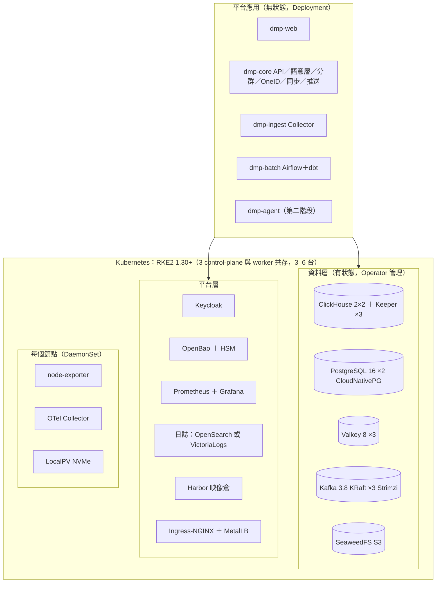

# 架構對照審查：V 平台（V-CDP／V-埋點分析／GMP）與 2025/07 提案舊棧 vs 目前方案

> 版本 v0.1（2026-10-19）。依三份參考材料審查目前方案：V 平台「智能營銷數據平台」的產品架構、功能／技術架構、數據流圖（V-CDP、V-埋點分析 埋點分析、GMP 營銷工具），以及本公司 2025/07 提案簡報的「系統部署示意圖」「系統架構與開源組件（數據模組／推薦模組）」三張投影片。
> 目前方案的依據：docs/02（後端架構）、docs/07（部署）、docs/12（架構圖）、docs/13（容量與機房）、docs/23（第一階段設計）、docs/32（開源元件清單）、docs/11（弱點評分）。

## 0. 結論先講

1. **功能層：對得上，缺的都是刻意不做或第二階段。** V-CDP 產品架構六層（數據接入、數據整合、統一檔案、數據分析、營銷應用、橫切的專案中心／隱私安全／運維監控／開放能力）我們都有對應模組；沒有的是公域／三方數據、廣告營銷、lookalike 與模型預測、即時營銷——前兩項不在本案範圍（台灣證券、資料不出境），後兩項是第二階段（AI、Flink）。
2. **技術層：V 平台是「十幾個有狀態服務」的大數據棧，我們是「五個」。** V 平台三個產品加起來用了 MySQL、Redis、Tendis、HBase、Hive、HDFS、Spark、Flink、Kafka、RocketMQ、V 平台 OLAP（ClickHouse 改寫版）（ClickHouse 改寫）、MinIO、FlinkX。我們把同樣的職責收斂到 ClickHouse、PostgreSQL、Valkey、Kafka、物件儲存五個（docs/11 §5），第一階段連 Flink／Kafka 都不啟用。這是刻意的：3–6 台機器、六人團隊、沒有 Hadoop 專家。
3. **2025/07 舊簡報的那三張投影片其實是V 平台私有化部署的元件清單**（K8s 1.19、Hadoop 2.10、Flink 1.11、MySQL 5.7、RocketMQ／ClickHouse「開源改寫」），多數版本已 EOL，而且是別人的棧。簡報要換成我們自己的清單（§4 給了可直接貼的表），否則客戶會拿舊投影片對照新方案問「為什麼不一樣」。
4. **審查找到 6 個要補的點**（§5）：Iceberg 需要目錄服務、機房日誌棧太重、標籤即時查詢的服務層容量要算、指標管理沒有 UI、簡報缺機房部署圖、元件版本要在 M1 開工時重新釘。都不影響架構，是補文件與一次決策。

## 1. 功能覆蓋：V-CDP 產品架構 vs 目前方案

| V-CDP 層 | V 平台的方塊 | 目前方案 | 狀態 | 說明 |
|---|---|---|---|---|
| 數據接入 | 企業一方私域數據（訂單、會員、人工、屬性、行為）、公私域打通、公域數據、三方公共數據 | GA360／BigQuery 匯出、數據中台批次（交易／帳務／開戶）、CRM CDC、舊平台歷史、`/v1/events` 直送 | 🟢 一方全部；⚪ 公域／三方不做 | 證券業資料不出境、沒有大陸廣告平台類公域來源；三方數據（徵信等）由客戶數據中台先合併，DMP 只收事實表 |
| 數據整合 | AI＋智能數據準備（清洗、機器學習、特徵工程、NLP、跨源建模、外部輸出）；OneID 構建（ID 接入、優先級、參考關係、生成策略、跨主體轉換） | 視覺化建模（映射／轉換／隔離區，docs/06）、OneID（識別優先序、強度、合併策略、登入後改寫，docs/19） | 🟢 清洗／建模／OneID；🟣 ML 特徵、NLP 第二階段 | OneID 規則比V 平台少「跨主體轉換」的 UI，但資料模型已有 user／account／item 三主體 |
| 統一檔案 | 數據檔案（主體屬性、行為事件、業務明細、維度屬性、數據管理、多主體建模）；標籤體系（規則、偏好、統計、運算、RFM、生命週期、導入、價值評估）；指標管理（常規、組合、單一、指標應用） | 元事件管理、用戶表管理、維度表與字典；標籤 10 種建立方式（第一階段做 5 種）；指標在 `metrics.yaml` 語意層 | 🟢 檔案與標籤；🟡 指標管理只有 yaml、沒有管理頁 | 見 §5.4 |
| 數據分析 | 畫像、生命週期、多主體、多維特徵、效果、算法模型預測 | 事件、漏斗、留存、路徑、歸因、用戶列表／細查、自定義 SQL、儀表板 | 🟢 六模組；🟣 模型預測第二階段 | V 平台的「效果分析」對應我們的歸因＋推送交付統計；「生命週期分析」靠 lifecycle 標籤 ＋ 留存 |
| 營銷應用 | 用戶分群（規則、多主體、上傳、lookalike）、即時營銷（規則、即時標籤、即時數據輸出）、廣告營銷（大陸廣告平台對接）、私域營銷（GMP、V-AB 測試） | 分群（規則、行為序列、導入名單、分析結果存檔）、受眾推送（Webhook／Kafka／GCS）、舊平台分群遷移 | 🟢 分群與推送；🟣 即時營銷（Flink）第二階段；⚪ lookalike、廣告、AB 不做 | MA 與 AB 測試由客戶既有工具負責（docs/22 §1）；DMP 只送名單與標籤 |
| 橫切 | 專案中心、隱私安全（脫敏、白名單、數據加密、脫敏策略）、運維監控、開放能力（API、數據輸出、組件 SDK、對接 Kafka） | 權限中心（五角色＋自訂、行級、遮罩、K 匿名、審批、審計）、系統監控（Prometheus／Grafana 同源）、Open API ＋ Tag Sync（REST／Kafka／GCS） | 🟢；🟡 專案中心只有 project 欄位、沒有註冊表 UI | 「組件 SDK」（嵌入式元件）不做；客戶要嵌的是看板，走 HTML 看板產出 |

結論：對客戶需求表（docs/26）來說沒有功能缺口；V 平台多出來的是「流量平台」場景（公域、廣告、lookalike），本案用不到。

## 2. 技術架構：V 平台三個產品的棧 vs 目前方案

V 平台的三張技術圖（V-CDP 技術架構、V-埋點分析 數據流、GMP 功能／數據流）合起來的元件，與我們的對應：

| 職責 | V 平台用什麼 | 目前方案 | 為什麼不一樣 |
|---|---|---|---|
| 行為事件 OLAP | V 平台 OLAP（ClickHouse 改寫版）（ClickHouse 開源改寫）／V-埋點分析 的 ClickHouse | ClickHouse 25.8 LTS（上游、不改寫）＋ Keeper | 改寫版無法跟上游安全修補；我們以 MV 聚合層、Bitmap、語意編譯器在上游版本上達到同樣查詢形狀（docs/36 基準） |
| 用戶檔案／標籤即時查詢 | Redis、Tendis（KV）、HBase（profile）、Profile Service | ClickHouse users 表＋`users_dict` 記憶體字典、Valkey（第二階段即時標籤） | 1,500 萬用戶的 profile 放 ClickHouse 字典即可（docs/13 §7）；不另養 HBase |
| 控制面（看板、分群定義、審批、審計索引） | MySQL | PostgreSQL 16 ＋ pgvector | 一個關聯式庫兼洞察向量索引；MySQL 5.7 已 EOL |
| 訊息匯流排 | Kafka ＋ RocketMQ（GMP 事務性佇列） | Kafka 3.8（KRaft）一條；第一階段只用於推送更新與原始事件落地 | 本案不做 MA 觸達，不需要事務性佇列；KRaft 去掉 ZooKeeper |
| 串流計算 | Flink（ETL、即時標籤、觸達任務） | 第一階段：暫存 Parquet → ClickHouse SQL 標準化 → dbt／Airflow 微批（docs/23 §2）；第二階段 Flink 1.20 只做 CEP 一個 job | 需求是 T+15 分鐘，不是秒級；少一個需要專家的元件 |
| 離線計算、冷層 | Spark、Hive、HDFS、DAG 排程 | 冷層 Iceberg on GCS（機房 SeaweedFS）；70 億歷史重算用 Spark／Trino（第二階段，docs/32 §2）；排程 Airflow 2.10（第一階段用 API 內建排程器） | 不養 Hadoop；物件儲存＋Iceberg 取代 HDFS＋Hive |
| ETL／接入 | FlinkX、bytex、ETL 引擎、Log Setting Service、SSID／WebID service | Go Collector（舊平台相容）、GA360 Importer（BigQuery Storage Read API）、dlt／Debezium（第二階段） | 第一階段埋點由 GA360 負責，Collector 只給無法經 GA 的來源 |
| 物件儲存 | MinIO、HDFS | GCS（CMEK）／機房 SeaweedFS | MinIO 是 AGPL（docs/32 §3 排除） |
| 服務註冊、設定 | Consul | Kubernetes Service／ConfigMap | K8s 原生 |
| 監控 | InfluxDB、JMX Metrics、LagMonitor、每節點 TMS agent | Prometheus ＋ OpenTelemetry Collector ＋ node-exporter（kube-prometheus-stack，每節點 DaemonSet）＋ Grafana OSS | 一套，平台內「系統監控」頁看同一組面板 |
| 日誌 | Loki | OpenSearch（機房）／Cloud Logging（GCP） | 見 §5.2，建議再評估 |
| 密鑰 | — | OpenBao（機房）／Secret Manager ＋ KMS（GCP） | 金融業必備，V 平台圖上沒畫 |
| 身分 | — | Keycloak（broker）或直連客戶 AD／Entra | 同上 |
| 映像倉、IaC | Docker Registry、Ansible | Harbor（機房）／Artifact Registry（GCP）、OpenTofu ＋ Helm | — |

有狀態服務數量：V 平台三產品合計約 12 個（MySQL、Redis、Tendis、HBase、Hive、HDFS、Kafka、RocketMQ、V 平台 OLAP（ClickHouse 改寫版）、MinIO、Flink state、InfluxDB）；我們核心 5 個（ClickHouse、PostgreSQL、Valkey、Kafka、物件儲存），機房平台面另有 SeaweedFS、OpenBao、OpenSearch、Harbor、Prometheus 5 個。

## 3. 2025/07 提案簡報三張投影片的審查

### 3.1 「系統部署示意圖」

舊圖：K8s 之上 20 個方塊（MinIO、Prometheus、ClickHouse、Ingress、Eagle、Loki、Consul、Consul Register、Grafana、GoShawk、MySQL、Redis、Tendis、Kafka、RocketMQ、Hadoop、HBase、ZooKeeper、Hive、Spark、LagMonitor、JMX Metrics、Tms Agent、ETCO、InfluxDB、Docker、Docker Registry、JDK、Python、Ansible）＋ 每節點 TMS agent。

| 舊圖元件 | 目前方案 | 處置 |
|---|---|---|
| MySQL 5.7／8.0 | PostgreSQL 16（CloudNativePG／Cloud SQL） | 替換 |
| Redis 6.2／7.0、Tendis | Valkey 8 | 替換（Redis ≥ 7.4 非 OSI 授權） |
| Kafka 2.1／2.8 ＋ ZooKeeper | Kafka 3.8 KRaft（Strimzi） | 升版、去 ZooKeeper |
| RocketMQ（開源改寫） | 不用 | 本案不做觸達佇列 |
| Hadoop 2.10／HDFS、Hive 2.3／1.2、HBase | SeaweedFS／GCS ＋ Iceberg；ClickHouse | 不養 Hadoop |
| Spark 3.2、Flink 1.11／1.15 | Spark 3.5／Trino、Flink 1.20（皆第二階段） | 升版、延後 |
| ClickHouse（開源改寫） | ClickHouse 25.8 LTS 上游 | 不用改寫版 |
| MinIO 5.0.5 | SeaweedFS／GCS | 授權 |
| InfluxDB、JMX Metrics、LagMonitor、Tms Agent | Prometheus ＋ node-exporter ＋ OTel（DaemonSet） | 一套 |
| Loki | OpenSearch／Cloud Logging（§5.2 建議 VictoriaLogs） | 評估 |
| Consul、Consul Register | K8s Service | 不需要 |
| Eagle、GoShawk、ETCO | V 平台自家元件 | 不適用 |
| Docker Registry、Ansible | Harbor／Artifact Registry、OpenTofu ＋ Helm | 替換 |
| JDK、Python | Temurin 17、Python 3.12 | 升版 |
| Kubernetes 1.19 | RKE2 1.30+／GKE | 升版（1.19 於 2021 EOL） |

### 3.2 「系統架構與開源組件：數據模組／推薦模組」

兩張表的版本（k8s 1.19.16、MySQL 5.7.37／8.0.36、Hadoop 2.10.2.3、Hive 1.2.2.10／2.3.10.0、Spark 3.2.4.1、Flink 1.11.3.3／1.15.3.3、Kafka 2.1.1／2.8.2.1、Redis 6.2.6、Tendis 2.4.3／2.7.1、MinIO 5.0.5）絕大多數已停止安全修補（docs/11 §2.1）。金融業季度弱掃會直接出現無法修補的 Critical；這兩張表不能再用。替換版見 §4。

「推薦模組」表裡的 RocketMQ、ClickHouse 標「開源改寫」，等於承諾維護一個 fork——我們的原則是全部上游 LTS、不改寫（docs/11）。

## 4. 給簡報用的替換內容（可直接貼）

### 4.1 系統部署示意圖（機房版；GCP 版見 docs/12 slide-4）

### 4.2 系統架構與開源組件（第一階段實際部署；版本以 docs/32 為準，M1 開工時重釘）

| 類別 | 元件 | 版本 | 授權 | 功能說明 |
|---|---|---|---|---|
| 容器平台 | Kubernetes（RKE2）／GKE | 1.30+ | Apache-2.0 | 容器編排；3 個 control-plane 與 worker 共存 |
| 容器平台 | Helm、OpenTofu | 3／1.8 | Apache-2.0／MPL-2.0 | 一套 umbrella chart 部署；IaC |
| 容器平台 | Harbor | 2.x | Apache-2.0 | 離線映像倉；Trivy 弱掃 |
| 線上存儲 | PostgreSQL ＋ pgvector（CloudNativePG） | 16 | PostgreSQL License | 控制面：看板、分群定義、審批、審計索引、洞察向量 |
| 線上存儲 | Valkey | 8 | BSD-3 | 快取、工作佇列、即時標籤（第二階段） |
| 分析存儲 | ClickHouse ＋ Keeper（Altinity operator） | 25.8 LTS | Apache-2.0 | 行為事件倉、MV 聚合層、分群／標籤 Bitmap、用戶檔案字典 |
| 分析存儲 | SeaweedFS（機房）／GCS | 3.x | Apache-2.0 | S3 API：Iceberg 冷層、原始事件、備份、同步輸出 |
| 訊息 | Apache Kafka（KRaft，Strimzi） | 3.8 | Apache-2.0 | 推送更新、原始事件落地；第二階段即時觸發輸入 |
| 計算 | Apache Airflow ＋ dbt-core | 2.10 | Apache-2.0 | 日批排程與 SQL 轉換（第一階段由 API 內建排程器執行） |
| 計算 | Apache Flink ＋ K8s Operator | 1.20 | Apache-2.0 | 第二階段：即時觸發 CEP（套件含、未啟用） |
| 計算 | Apache Spark／Trino／Iceberg | 3.5／4xx／1.6 | Apache-2.0 | 第二階段：70 億歷史重算、冷層查詢 |
| 身分與密鑰 | Keycloak；OpenBao ＋ HSM（機房）／Secret Manager ＋ KMS（GCP） | 25；2.x | Apache-2.0；MPL-2.0 | SSO／OIDC；密鑰只存參照 |
| 觀測 | Prometheus ＋ OTel Collector ＋ node-exporter；Grafana OSS | 2.x／0.1x；11.x | Apache-2.0；AGPL-3.0（內部使用） | 指標與告警；平台「系統監控」頁同源 |
| 觀測 | VictoriaLogs（或 OpenSearch；docs/37 §5.2） | 1.x／2.x | Apache-2.0 | 日誌 |
| 執行環境 | Python、Go、Node、Temurin JDK | 3.12、1.23、22 LTS、17 | PSF／BSD／MIT／GPLv2+CE | core／ingest／web／Flink |
| 作業系統 | RHEL 9／Rocky Linux 9；UBI 9 minimal 映像基底 | 9.4+ | — | SELinux enforcing；容器無 root、唯讀檔案系統 |

## 5. 審查發現與建議

### 5.1 Iceberg 冷層需要目錄服務（第二階段，現在要決定）
V 平台用 Hive Metastore 當表目錄。我們的冷層是 Iceberg，docs/02／32 沒說目錄用什麼。選項：PostgreSQL JDBC catalog（零新元件，用既有 PG）、Apache Polaris（REST，Apache-2.0，2025 畢業）、Nessie（Apache-2.0）。**建議 JDBC catalog**：不加元件，Trino／Spark／ClickHouse 的 Iceberg 引擎都支援。寫進 docs/02 第二階段章節。

### 5.2 機房日誌棧太重
OpenSearch 是 JVM 叢集，3 台機器的 C 檔要再分出 3 個 Pod 與磁碟給它。V 平台與舊簡報用 Loki（AGPL-3.0，與 Grafana OSS 同一授權口徑，我們已接受內部使用）；另一個選項 VictoriaLogs（Apache-2.0，單一執行檔、資源約 OpenSearch 的 1/5）。**建議 VictoriaLogs**，Grafana 有原生 datasource。改 docs/32 §1.1 與 Helm values-onprem。

### 5.3 標籤即時查詢的服務層容量要算
V 平台用 Redis／Tendis／HBase 承接「profile service」的線上讀。我們第一階段的 Tag Sync API 走 ClickHouse（docs/13 §6），第二階段即時觸發要 Valkey。1,500 萬用戶 × 500 標籤若以 Bitmap 存 Valkey 沒問題（每標籤一個 Roaring bitmap，約 1 GB 內）；若以「一人一 hash」存則 >20 GB，三台 Valkey 放不下。**在 docs/13 §6 補一段：即時標籤只存 bitmap（標籤 → 人），不存 hash（人 → 標籤）；人 → 標籤查詢走 ClickHouse。**

### 5.4 指標管理沒有 UI
V 平台「指標管理」是獨立模組（常規／組合／單一指標）。我們的指標在 `metrics.yaml`，改動走契約 PR，分析師不能自己登記。第一階段可接受（docs/26 需求表沒要求），但簡報要講清楚「指標由數據治理用 yaml 管理、版本控管、CI 黃金測試守門」是優點不是缺口；第二階段在數據治理加「指標目錄」頁（唯讀 → 登記草稿 → 契約）。

### 5.5 簡報缺機房部署圖
docs/12 的 slide-4 只有 GCP 版；客戶若選機房（docs/13 §11），簡報上沒有對應圖。用 §4.1 的圖補一張 slide-5（`docs/diagrams/build_slides.py` 加一個函數），並把 §4.2 的表取代舊簡報的兩張元件表。

### 5.6 元件版本在 M1 開工時重釘
docs/32 的版本是 2026-10-17 寫的；M1（2027 Q1）開工時 PostgreSQL 17／18、Airflow 3、Keycloak 26、Kubernetes 1.32、ClickHouse 下一個 LTS 都可能更合適。原則不變（上游 LTS、有 Operator、OSI 授權），但簡報和合約附件要寫「以開工時 LTS 為準」，不要釘死版本號。

### 5.7 不需要改的（審查後確認）
- 每節點 agent：kube-prometheus-stack 已含 node-exporter DaemonSet，對應舊圖的「每節點 TMS agent、metrics」。
- 備份：ClickHouse `BACKUP TO S3` 每日增量、每週全量；PostgreSQL WAL 歸檔；Kafka 不備份（docs/13 §11.4）。可再加 Velero 備份 K8s 物件（選配）。
- 不做 RocketMQ／GMP 類觸達佇列：MA 與 LINE 觸達不在本案（docs/22 §1 已與客戶確認）。
- 不用 ClickHouse 改寫版：基準（docs/36）證明上游版本在 1 億筆下 P95 在目標內。

## 6. 行動清單

| # | 事項 | 文件 | 工時 |
|---|---|---|---|
| 1 | Iceberg 目錄決定 JDBC catalog，寫進 docs/02 第二階段 | docs/02 | 0.5 天 |
| 2 | 日誌改 VictoriaLogs：docs/32、Helm values-onprem、docs/13 §11.4 | docs/32、deploy/helm | 1 天 |
| 3 | docs/13 §6 補即時標籤只存 bitmap 的容量說明 | docs/13 | 0.5 天 |
| 4 | ~~簡報：加機房部署圖 slide-5、以 §4.2 表取代舊元件表、註明「版本以開工時 LTS 為準」~~（已做：`docs/diagrams/slides/slide-5-onprem-deployment`、簡報 14b–14d、規格書 §1.1） | docs/diagrams、docs/decks、docs/17 | 完成 |
| 5 | 數據治理第二階段加「指標目錄」頁（列入 docs/17 §5a 待做） | docs/17 | 0.5 天 |
